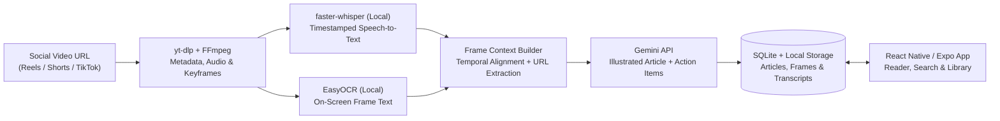

# ReadAfter 📱


**ReadAfter** is a full-stack mobile application (**FastAPI + React Native/Expo**) that transforms short-form social media videos (Reels, Shorts, TikToks) into structured, searchable, **illustrated articles**. It combines on-device speech-to-text (`faster-whisper`) and optical character recognition (`EasyOCR`) with multimodal LLM synthesis so you can read, search, and act on saved videos without rewatching them.

---

## ✨ Key Features

- **Hybrid Local + Cloud Processing Pipeline:** Audio transcription (`faster-whisper`) and on-screen text extraction (`EasyOCR`) run 100% locally on your host machine—keeping raw media private and API token costs minimal.
- **Temporal Frame-to-Speech Alignment:** Automatically distributes keyframe extraction across the video's duration and aligns each frame with its surrounding timestamped speech segments and OCR text (`frame_context.py`).
- **Illustrated Article Generation:** Converts chaotic short-form videos into clean, readable articles with inline keyframe illustrations, central theme summaries, extracted URLs/links, and actionable checklists.
- **Full Transcript Archive:** Generates a downloadable plaintext report (`transcricao.txt`) per video containing metadata, full continuous transcript, timestamped segments, and per-frame OCR captures.
- **Cross-Platform Expo Mobile Client:** Browse your library, filter by tags, read illustrated articles, inspect raw transcripts, and configure backend endpoints directly from Android or iOS.

---

## 🏗️ Processing Pipeline



---

## 🛠️ Tech Stack

| Layer | Technologies |
| :--- | :--- |
| **Mobile App** | React Native `0.81`, Expo SDK `54`, React Navigation, Axios |
| **Backend API** | Python `3.10+`, FastAPI, Uvicorn, SQLite |
| **Media & Local AI** | `yt-dlp`, `ffmpeg`, `faster-whisper` (`large-v3`), `EasyOCR` (`pt,en`), Pillow |
| **LLM Synthesis** | Google Gemini (`google-genai`) |

---

## 🚀 Getting Started

### Prerequisites
- **Node.js 18+**
- **Python 3.10+** and **FFmpeg** installed on your system `PATH`
- A **Google Gemini API Key** (`GOOGLE_API_KEY`)
- **Expo Go** on your physical device or an Android/iOS emulator

### 1. Clone & Configure Environment

```bash
git clone https://github.com/gabzieg/ReadAfter.git
cd ReadAfter
cp .env.example .env
```

Edit `.env` and set your `GOOGLE_API_KEY` and local network address (`EXPO_PUBLIC_API_URL`):
- Use `http://10.0.2.2:8000` for the Android Emulator.
- Use your computer's LAN IP (e.g., `http://192.168.0.15:8000`) when testing on a physical phone.

### 2. Run the FastAPI Backend

```bash
python -m venv venv

# Windows:
venv\Scripts\activate
# macOS / Linux:
source venv/bin/activate

pip install -r requirements.txt
uvicorn app.main:app --host 0.0.0.0 --port 8000 --reload
```

### 3. Run the React Native / Expo App

Open a second terminal in the project root:

```bash
npm install
npm start
```

Scan the QR code with **Expo Go** or press `a` / `i` to launch on an emulator.

---

## 📁 Project Structure

```text
ReadAfter/
├── app/                          # FastAPI Backend
│   ├── core/                     # Environment config & in-memory job queue state
│   ├── db/                       # SQLite schema, migrations & repository layer
│   ├── routers/                  # REST endpoints (/reels, job status, static media)
│   ├── services/
│   │   ├── pipeline.py           # Async queued processing orchestrator
│   │   ├── video_ops.py          # yt-dlp metadata/audio downloader & FFmpeg frame sampler
│   │   ├── stt_ops.py            # Local faster-whisper speech transcription
│   │   ├── ocr_ops.py            # Local EasyOCR on-screen text extraction
│   │   ├── frame_context.py      # Temporal frame-to-speech alignment & link extractor
│   │   ├── ai_ops.py             # Gemini prompt assembly & structured article synthesis
│   │   └── export_ops.py         # Plaintext transcript & OCR exporter
│   └── main.py                   # FastAPI entrypoint & CORS middleware
├── src/                          # React Native / Expo Mobile Client
│   ├── navigation/               # Stack & tab navigation (AppNavigator.js)
│   ├── screens/                  # HomeScreen, DetailScreen & SettingsScreen
│   └── services/                 # Axios API client & design tokens (theme.js)
├── .env.example                  # Documented environment template
└── requirements.txt              # Backend Python dependencies
```

---

## 📄 License

Distributed under the MIT License. See [`LICENSE`](LICENSE) for details.
